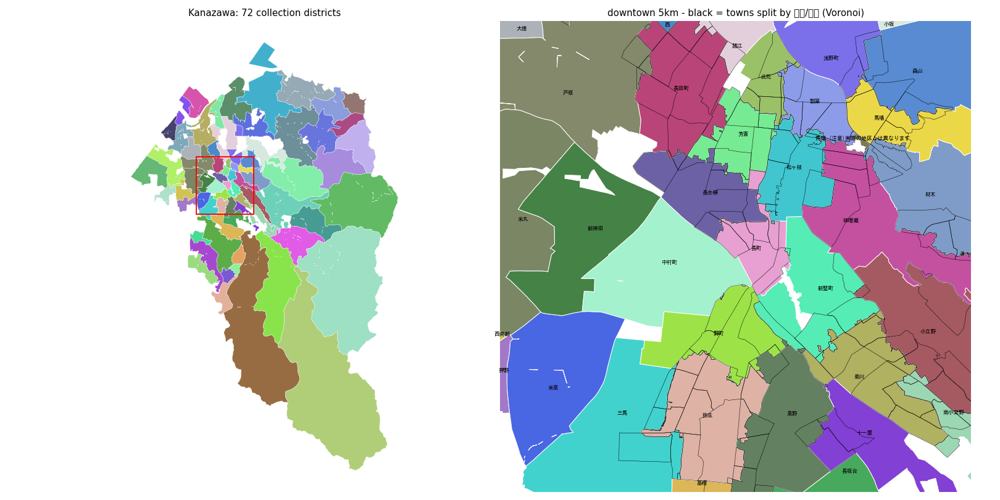

# gomisute-gps — 位置情報ひとつで「今日のごみ」を答える

> 行政がごみ収集日のデータ形式を統一しないなら、民間側で全国 1,741 自治体分を構造化してしまえばいい。
> GPS の緯度経度から「収集区域 → 今日・明日出せるごみ」を一発で返すサービスの、データ基盤の研究実装です。

*Built with Claude Code — [Built with Claude: Japan 2026](https://cerebralvalley.ai/e/built-with-claude-japan2026) 応募作品*

## なぜ難しいのか

ごみ収集日は「住所 → 収集地区 → 曜日ルール」の2段引きですが、どちらの段も自治体ごとにバラバラです。

| 問題 | 実例 |
|---|---|
| 収集区域ポリゴンを公開している自治体は **0** (12自治体を調べた結果) | 区域は町丁目名のリストで配られる |
| 町丁目より細かい区切りがある | 番地範囲 (横浜・大阪・金沢・札幌) / 道路境界 (宇都宮) / 団地・集積所単位 (世田谷・大阪・高知) |
| 区域表に**もう存在しない町名**が残っている | 金沢: 住居表示で消えた「笠舞町」「西念町」などが現役で載っている |
| 日付ルールが「第N曜日」とは限らない | 長野: 月1回品目は**28日ローテーション**で、GW・年末に位相がずれる |
| 更新周期がバラバラ | 年度(4月)・暦年(12月)・秋(9月)・2か月ごと |

## ここまでの成果

### 1. 収集日ルールの正規化 (`normalize.py`)
- **世田谷区** (CSV オープンデータ): 118行 / 275町丁目 / 472スケジュール → RRULE。パースエラー0、LLM不要
- **長野市** (365日×品目の○マトリクス zip): 366スケジュールを
  単一RRULE 112 / 区間分割RRULE 250 / 明示日付 4 に圧縮し、**全件を元データと往復一致**で検証

### 2. 収集区域のポリゴン化 (`kz_tables.py` → `kz_rules.py` → `split_blocks.py`)
金沢市の区域表 HTML (1,776ルール) × e-Stat 町丁目ポリゴン × 地理院 住居表示点 (12万点) から、71収集地区のポリゴンを生成。

- 914町のうち町丁目まるごと 793 (86.8%)、残りは住居表示点のボロノイ分割
- 面積カバー率 96.6% / 重なり 0 / 全市 4 秒
- **20% ホールドアウト精度 96.1%** (分割町のみ、n=9,309、`out/kanazawa_holdout.json`)



### 3. 旧町名の検証 — ABR は「履歴台帳」ではなかった (`fetch_abr.py` → `abr_check.py` → `census_lineage.py`)
ポリゴンが引けなかった32町を、デジタル庁 アドレス・ベース・レジストリ (ABR) で検証しました。

- ABR 町字マスター (全国 727,467 行) には**廃止日・別名が1件も入っていない**。効力発生日の 98.6% は 1947-04-17 (地方自治法施行日のプレースホルダ)
- しかも **ABR に無い ≠ 廃止**。郵便番号が現役の北安江町・西念町や、地番の登記が無い残存地 (西堀川町・笠舞町など) も ABR から漏れている
- 32町の内訳: ABR にも国勢調査2020にも無い 15 / 旧町名＋イロハ小字の行だけが残る 3 / 区画整理の仮称 1 / 区域表が丁目を省略 3 / ABR に現存するが国勢調査2020に無い 10
- **国勢調査小地域 2000→2020 の差分**を面積按分すると、消えた町名と後継町を機械的に取り出せる (金沢で10件)。それより前は、Claude の調査エージェントが市の換地図 PDF・県公報の告示番号・郵便番号簿を当たり、別の反証エージェントが検証した (19町: 確認13 / 訂正5 / 根拠不足1)
- 町名は数十年かけて段階的に消え (柳町 1965→1992→1993)、別の範囲で復活もする (観音町 2019)。→ 正規化 Worker は「町名→町名」の表ではなく**変更イベントの履歴**として設計した ([docs/address-normalize-schema.md](docs/address-normalize-schema.md))
- ABR 地番マスター位置参照拡張 (金沢 28.7万筆の代表点) は、字・地番型の区域分割に使える

詳細は [docs/abr_check.md](docs/abr_check.md)、系譜データは `out/kanazawa_town_alias*.csv`。

## スキーマ
### 収集区域と収集日 (v0.1)
- `zone`: zone_id, muni_code, members (町丁目コード), exceptions[], geom (MultiPolygon), confidence, source{url, fetched_at, hash}
- `schedule`: zone_id, category, rule_kind (`rrule` | `segments` | `explicit`), rrule, exdates, rdates, valid_from/to, source
- API 案: `GET /resolve?lat&lng&date` → zone_id, confidence, today[], tomorrow[] (confidence < 0.7 なら境界候補を返して利用者に選ばせる)
- 経路: gps2city (緯度経度 → lg_code・区) → 収集地区タイル → 境界までの距離で confidence

### 町名の正規化: address-normalize (v0.2 設計、[docs/address-normalize-schema.md](docs/address-normalize-schema.md))
自治体の資料に書かれた町名 (旧町名を含む) を現行の町字 ID に寄せる別 Worker (Cloudflare D1)。

- 町名をキーにせず、**町字の実体・表記・変更イベント・土地の移転**を分けて持つ (段階的な消滅・中間町名・復活に対応)
- 有効期間の境界は lo / hi / best の幅で持ち、「大半が移った日」と「名前が最後に消えた日」を分ける
- すべての事実に確信度・反証検証の結果・出典 (同じ元リスト由来の資料は1票) を付ける
- 照合キーは canon (同一視してよい) と fold (ノ/の など衝突しうる) の2段。fold で複数に当たったら自動で選ばない
- 設計は方針の違う3案を Claude に独立に作らせ、審査役が採点・統合 (16表、[DDL](docs/address-normalize-schema.sql))。
  全国 ABR 749,603 行 (296MB) と金沢の10ケースで検証済み ([prototypes/address-normalize/](prototypes/address-normalize/))

## 再現手順

Python 3.11+ / pandas / geopandas / shapely 2 / python-dateutil

```bash
# 金沢
python fetch.py https://www4.city.kanazawa.lg.jp/soshikikarasagasu/gomigenryosuishinka/gyomuannai/1/3/2/20102.html data/kanazawa_rules.html
python fetch_geo.py 17201          # 国勢調査2020 小地域
python kz_tables.py && python kz_rules.py
python split_blocks.py             # --holdout で 20% 点ホールドアウト精度 → out/kanazawa_holdout.json
# 旧町名の検証
python fetch_abr.py 172014 --all   # ABR (町字・地番・住居表示)
for y in 2000 2005 2010 2015; do python fetch_geo.py 17201 $y; done
python abr_check.py && python census_lineage.py
```

地理院 住居表示住所 (`data/gsi_jukyo_17201.zip`, 2025-07-31版) は [国土地理院](https://www.gsi.go.jp/) から手動取得し `geo_peek.py` で CSV 化。
長野は [長野市 ごみ収集カレンダー オープンデータ](https://www.city.nagano.nagano.jp/n023500/contents/p006280.html) の `gomi_calendar_2026.zip`、世田谷は世田谷区オープンデータの「資源・ごみ収集日」CSV。

## データ出典
- デジタル庁「アドレス・ベース・レジストリ」([利用規約](https://www.digital.go.jp/policies/base_registry_address_tos))
- 総務省統計局 e-Stat「国勢調査 小地域 (町丁・字等別) 境界データ」2000〜2020
- 国土地理院「電子国土基本図 (地名情報) 住居表示住所」
- 金沢市「地区別収集カレンダー」区域表 / 長野市・世田谷区 ごみ収集日オープンデータ

`out/` の成果物は上記データからの加工物です。生データは `data/` に取得されます (リポジトリには含めません)。

## 関連
- [gps2city](https://github.com/firemio/gps2city) — 緯度経度 → 都道府県・市区町村 (国土数値情報 N03 を 0.1° タイル化した Cloudflare Worker、[稼働中](https://gps2city.firemio.workers.dev/))。
  **Rust を WebAssembly にして Cloudflare Workers で動かし、全国のタイルを1本のパック (約23MB) にして Worker に埋め込んでいる**ので、初めて問い合わせる地点でも応答は中央値 11ms (外部読み込みだった頃は 250〜310ms、距離の誤差は最大 0.97m)。
  タイルの行政区域コードに検査数字を付けると ABR の市区町村コードと 1,898/1,905 件一致 (残り7件は所属未定地)。
  2026-10-17 から `POST /location` が `lg_code` (ABR と同じ6桁) と政令市の `ward` を返し、`/location2` は区ごとの境界距離 (`areas`) を返す。
  `/resolve` の入口 (GPS → 市区町村コード)、収集地区ポリゴンの配信 (同じタイル方式)、境界までの距離による確信度に使う
- address2houmukyoku (同じ作者の別プロジェクト・非公開) — 住所 → 管轄法務局。旧市町村→現市町村 1,801件 (1986〜2019) を address-normalize の市区町村層の下地にする。
  照合・正規化・12万件の郵便番号回帰検証・ハッシュ差分 LLM 抽出・特殊分割 (のうち/を除く/の一部) から得た知見は [docs/prior-art-address2houmukyoku.md](docs/prior-art-address2houmukyoku.md) にまとめた (コードは転載していない)
- 引き継ぎメモ: [HANDOFF.md](HANDOFF.md)
